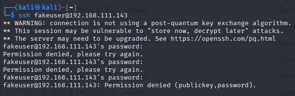
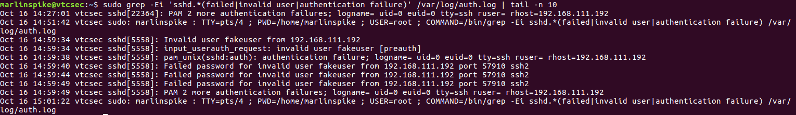
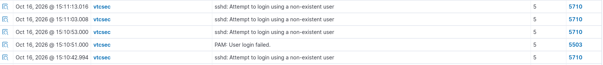
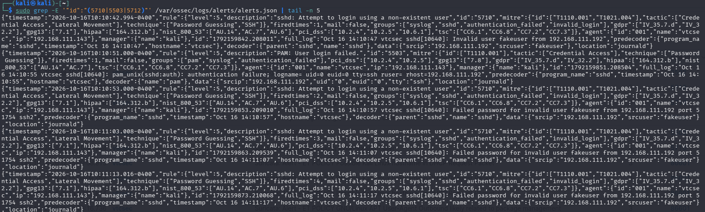
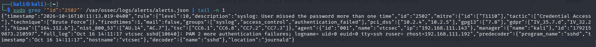
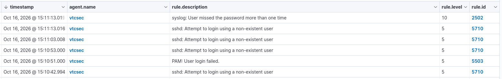

# Wazuh Brute-Force Detection Lab

## Project Overview

This project demonstrates how Wazuh can monitor Linux authentication events, identify repeated failed SSH login attempts, and generate security alerts for investigation.

The test was performed in an authorized home SOC lab using Kali Linux as the testing system and Ubuntu as the monitored endpoint.

## Lab Environment

- **SIEM:** Wazuh 4.14.7
- **Testing system:** Kali Linux
- **Monitored endpoint:** Ubuntu Linux (`vtcsec`)
- **Log collection:** Wazuh agent using journald
- **SSH target:** `192.168.111.143`
- **Testing system IP:** `192.168.111.192`

## Test Procedure

A controlled SSH authentication test was conducted from Kali Linux against the Ubuntu endpoint using a nonexistent username:

```bash
ssh fakeuser@192.168.111.143
```

The login attempts failed as expected. Authentication logs were examined on Ubuntu, and the corresponding events were reviewed in the Wazuh dashboard and manager alert logs.

## Detection Results

| Wazuh Rule ID | Severity Level | Detection |
|---|---:|---|
| 5710 | 5 | SSH login attempt using a nonexistent user |
| 5503 | 5 | PAM authentication failure |
| 2502 | 10 | Multiple authentication failures reported by PAM |

Rule 2502 generated a higher-severity, brute-force-related alert following repeated authentication failures.

## Analysis

The results confirmed that Wazuh received authentication events from the Ubuntu endpoint, matched them against detection rules, and displayed the resulting alerts for investigation.

The activity was generated deliberately in a controlled lab. The evidence demonstrates failed authentication attempts, not successful unauthorized access or confirmed system compromise.

## Evidence

### 1. SSH Failed-Login Test from Kali Linux



### 2. Ubuntu SSH Authentication Log



### 3. Wazuh SSH Authentication Alerts



### 4. Wazuh Authentication Alert JSON



### 5. Wazuh Brute-Force-Related Alert — Rule 2502



### 6. Wazuh Dashboard — Overview of SSH Authentication Alerts




## Security Lessons

- Centralized logging helps analysts investigate authentication failures.
- Individual failed-login alerts provide useful context about usernames and source addresses.
- Higher-severity alerts can help prioritize investigation, but analysts should validate the underlying event details.
- A detection alert is an investigative signal, not proof of compromise.

## Conclusion

This lab demonstrated end-to-end monitoring and investigation of repeated failed SSH authentication using Wazuh. It provided practical experience reviewing Linux authentication logs, interpreting detection rules, and documenting findings in a SOC incident report.
